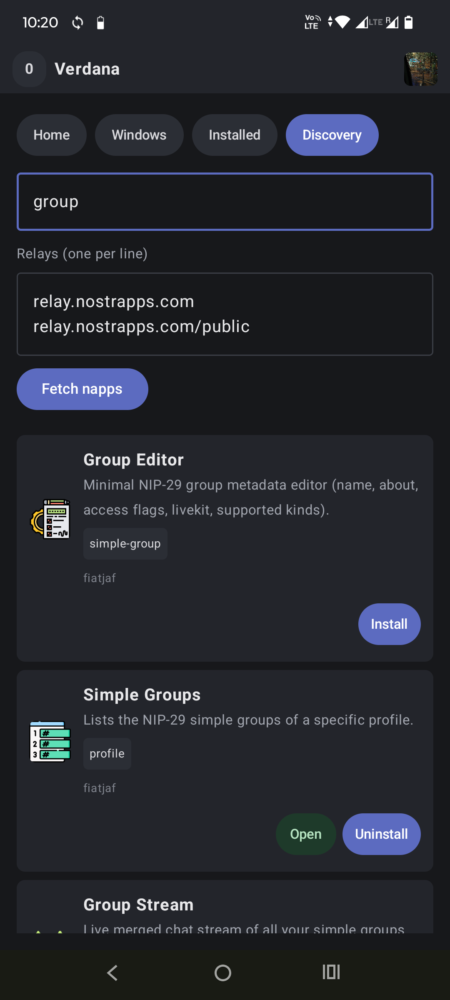
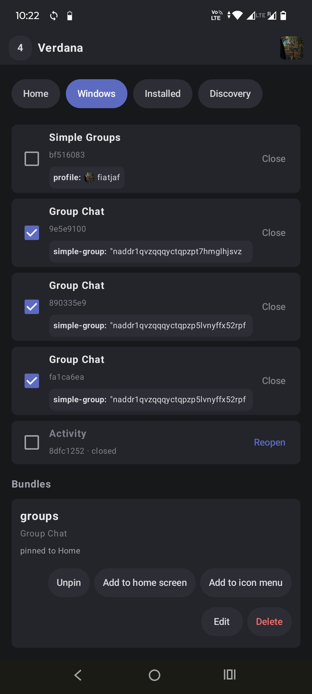
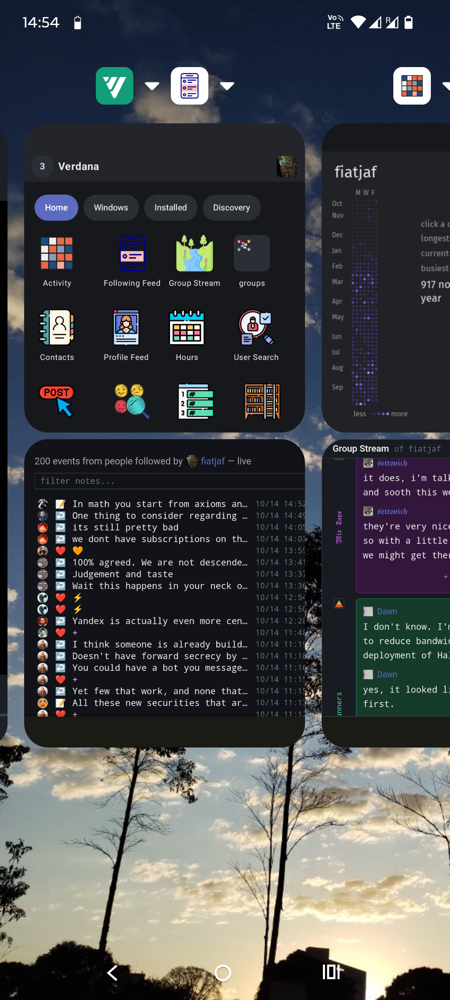

# Verdana

Napps are small apps that do one thing and (hopefully) do it well. They can be written in HTML or they can be raw WASM with custom UI rendering.

Because they don't do all the things, they can invoke other napps to do these other things. You install each app individually plug one into the other during your usage session.

  

Verdana is a launcher for napps. Besides running the napps and passing messages between each other, it also allow you to create shortcuts for specific napps or groups of napps and save them as application shortcuts (on desktop), on your phone's home screen or as a quick launch menu (on Android), or in an in-app home screen.

